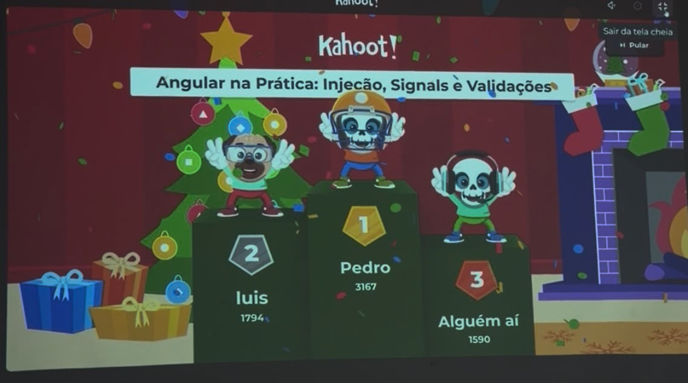
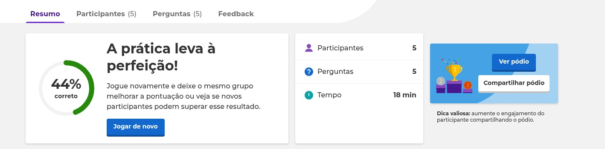
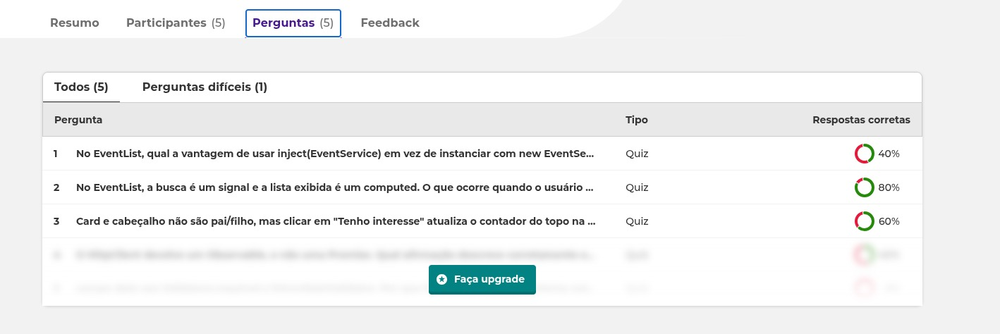
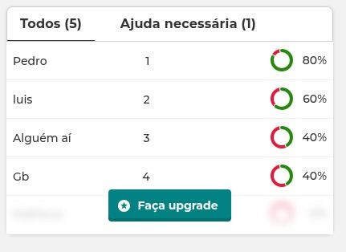

# Relatório pós-seminário · Angular

Seminário 3 de 3 · Mural de Eventos do Curso · Marcelly Almeida, Marcelle Luna e Gabriel Barbosa.

## Oficina

A turma tinha **5 participantes**: 1 dupla e 3 pessoas trabalhando sozinhas, ou seja, 4 grupos.

| Parte | Requisito | Tempo | Grupos que concluíram | Até onde os outros chegaram |
| :--- | :--- | :--- | :--- | :--- |
| 1 · Cadastrar evento | RF3 | 15 min | 1 de 4 (a dupla) | Os 3 fizeram os TODOs 1, 2 e 4; nenhum fez o 3 e o 5 |
| 2 · Ver detalhe | RF4 | 15 min | 4 de 4 | — |
| 3 · Marcar interesse | RF5 | 12 min | 1 de 4 (a dupla) | 2 pessoas chegaram até o TODO 3 e 1 até o TODO 2 |

- **Onde a turma mais travou:** na parte 1, nos TODOs 3 (validadores do formulário) e 5 (enviar pelo serviço com `subscribe`). Os TODOs que só pediam diretivas no HTML (`formControlName`, `@for` e `@if`) todos fizeram; travaram os que pediam escrever TypeScript com uma API nova. Na parte 3, o tempo (12 minutos) não bastou para os botões do TODO 4.
- **Problema de ambiente:** os computadores do laboratório tinham o **Node 24.13**, e o Angular 22 exige no mínimo o **24.15**. Sem permissão para instalar outra versão, **ninguém conseguiu rodar o projeto**: a turma escreveu a solução de cada parte no código, mas não viu o resultado no navegador. Para compensar, o professor Humberto conseguiu um projetor separado, e o Gabriel mostrou cada solução funcionando no próprio computador.
- **Tempo:** a oficina somou **42 minutos**, abaixo dos 45 pedidos. O atraso veio do problema com o Node: logo no início da apresentação, durante a abertura e os fundamentos, o grupo tentou resolver a versão do Node na máquina, mas não tinha permissão para instalar a versão exigida pelo Angular. Esse tempo saiu da oficina, e mesmo assim as três partes foram feitas, sem cortar nenhuma.

## Dúvidas

A turma **não fez perguntas** durante a apresentação nem durante a oficina. As travas nos TODOs 3 e 5 da parte 1 foram resolvidas apontando os modelos que o próprio projeto já tinha: o filtro de categorias e o `subscribe` do `event-list.ts`, escritos no live coding.

## Quiz e pergunta-chave

As **5 pessoas** responderam ao quiz no Kahoot. O pódio ficou com Pedro (3.167 pontos), luis (1.794) e Alguém aí (1.590).

- **Resultado geral:** 44% de acerto (11 respostas certas em 25).

O quiz se chamou **"Angular na Prática: Injeção, Signals e Validações"** e teve 5 perguntas de múltipla escolha, na ordem abaixo. As alternativas e o gabarito comentado estão em `docs/quiz.md` (lá, as perguntas 2 e 3 estão em ordem invertida).

| Pergunta | Enunciado no Kahoot | Acerto |
| :--- | :--- | :--- |
| 1 | No EventList, qual a vantagem de usar `inject(EventService)` em vez de instanciar com `new EventService()`? | 40% (2 de 5) |
| 2 | No EventList, a busca é um signal e a lista exibida é um computed. O que ocorre quando o usuário digita na busca? | 80% (4 de 5) |
| 3 | Card e cabeçalho não são pai/filho, mas clicar em "Tenho interesse" atualiza o contador do topo na hora. Por quê? | 60% (3 de 5) |
| 4 | O HttpClient devolve um Observable, e não uma Promise. Qual afirmação descreve corretamente essa diferença? | 40% (2 de 5) (estimado)|
| 5 | O campo data usa `Validators.required` e `futureDateValidator`. Por que `futureDateValidator` retorna `null` se vazio? | **0% (ninguém acertou)** (estimado) |

A versão gratuita do Kahoot só mostra o acerto das 3 primeiras perguntas. O da pergunta 5 foi confirmado pelo grupo: ninguém acertou. O da pergunta 4 sai da conta: 44% de 25 respostas são 11 acertos, as perguntas 1 a 3 somam 9, e os 2 que sobram são todos da pergunta 4.

- **Acerto por participante:**

| Posição | Participante | Acerto |
| :--- | :--- | :--- |
| 1 | Pedro | 80% (4 de 5) |
| 2 | luis | 60% (3 de 5) |
| 3 | Alguém aí | 40% (2 de 5) |
| 4 | Gb | 40% (2 de 5) |
| 5 | (nome ilegível na imagem) | 0% (estimado) |

O 5º participante também foi estimado: os quatro primeiros somam 4 + 3 + 2 + 2 = 11 acertos, que já é o total do jogo. O anel borrado é todo vermelho, e o Kahoot marca 1 participante como "Ajuda necessária".

- **Questão com mais erros:** a 5, sobre validação, que **ninguém acertou** e foi a única marcada como difícil pelo Kahoot. **Hipótese:** é exatamente o assunto do TODO 3 da parte 1, que só a dupla fez. A maior parte da turma não chegou a escrever os validadores, e a ideia de que `null` significa "válido" é contraintuitiva para quem vê Reactive Forms pela primeira vez. A pergunta 1 (40%) também chama atenção: a injeção de dependências era o conceito central, e o resultado combina com a pergunta-chave, em que a resposta da turma não chegou ao ponto principal sem ajuda.
- **Pergunta-chave** ("Que problema a injeção de dependências resolve que importar diretamente uma classe não resolve?"): uma pessoa respondeu, no caminho certo, mas sem destacar o ponto principal. O grupo completou a resposta (acoplamento, inversão de dependência e troca do serviço por um dublê no teste), e o professor Humberto acrescentou o seu complemento.
- O professor não fez perguntas. Os horários foram cumpridos, e houve tempo para mostrar o extra da branch `layout-plus` no fechamento.

## O que mudaríamos

- **Mais tempo de oficina.** A melhor forma de aprender é colocar a mão na massa, e 42 minutos foram pouco para três partes, principalmente com a turma vendo Angular pela primeira vez.
- **Testar o projeto no laboratório antes.** Na descrição do Seminario, pede que um integrante siga o passo a passo do README numa máquina da universidade, antes do seminario. Isso teria mostrado o Node 24.13 a tempo de pedir a atualização ao laboratório ou de ajustar a versão exigida.
- **Ter um plano para quando o ambiente falha.** Por exemplo, uma versão do projeto que rode no navegador, sem instalar nada, para a turma ver o resultado do próprio código.

## Reflexões

As três reflexões do enunciado foram respondidas durante a apresentação: injeção de dependências versus importação direta, Observables ou Signals, e o custo das convenções.
